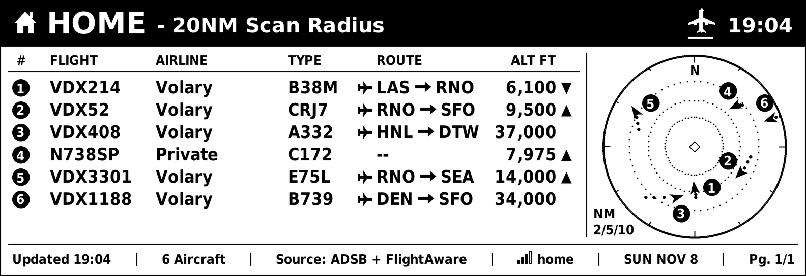
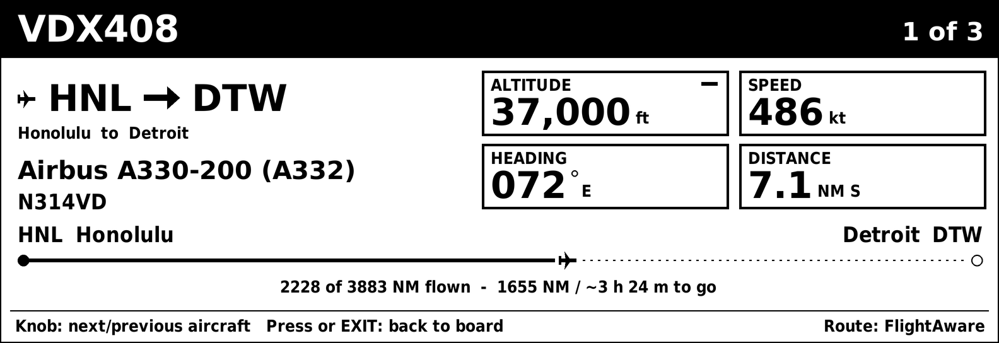
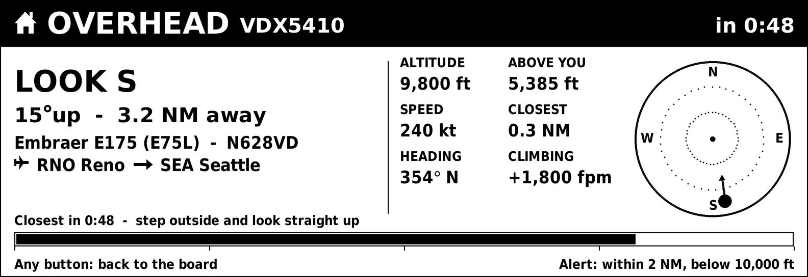

# Flight Board

**Live air traffic on an always-on e-ink display.** Flight Board shows the aircraft around your home or any airport you choose: flight, airline, aircraft type, route, altitude and a small radar. It tells you when a plane is about to pass overhead so you can step outside and look up.

It runs on an Elecrow CrowPanel ESP32-S3 5.79" e-paper display and is configured from a web console that opens in any browser on your network.

By [Volary Dynamics](https://volarydynamics.com).

| Aircraft details | Overhead alert |
|---|---|
|  |  |

## Features

- **Live ADS-B traffic** from free, community-run sources (adsb.lol, with adsb.fi and airplanes.live as backups).
- **Home, airports and other places.** Your home, up to 8 airports and 3 other places, each with its own scan radius. Turn the knob to switch.
- **Airport logic.** At an airport, each flight is labelled ARRIVING, DEPARTING, OVERHEAD or OVERFLIGHT from what the aircraft is actually doing.
- **Route checks.** Free route data is often out of date because airlines reuse flight numbers. The board checks each route against where the plane is and which way it's heading, and leaves it blank rather than show a wrong one.
- **Better Routes (optional).** Add your own FlightAware AeroAPI key (Personal plan) and the board asks FlightAware for the real route when the free one looks wrong. Monthly limit, pacing, and a choice of which flights to ask about keep the cost low.
- **Overhead alert.** A countdown, look angle and sky view when an aircraft is about to pass over your home.
- **Web console.** Remote control, every setting, firmware updates from the browser, and a Diagnostic Log. No app and no cloud account.
- **Radar LCD add-on (optional).** A 1.28" round GC9A01 screen as a live radar scope, with four styles.

## Hardware

- **Elecrow CrowPanel ESP32-S3 5.79" e-paper HMI display** (792 x 272, black and white).
- USB-C cable and power.
- Optional: 1.28" 240 x 240 GC9A01 round LCD and 7 male-to-female jumper wires.

### Radar LCD wiring (optional)

| LCD pin | CrowPanel |
|---|---|
| VCC | 3V3 |
| GND | GND |
| SCL | IO15 |
| SDA | IO17 |
| DC | IO21 |
| CS | IO9 |
| RST | not connected |

Never connect VCC to 5 V. Unplug USB while wiring.

## Building and installing

1. Install the [Arduino IDE](https://www.arduino.cc/en/software) and the **esp32** boards package by Espressif.
2. Install these libraries from the Library Manager: **GxEPD2** (with Adafruit GFX), **ArduinoJson** (v7), **Adafruit GC9A01A**.
3. Open `flight_board/flight_board.ino`. The other files in the folder open as tabs; they are all part of the program.
4. Tools menu:
   - Board: **ESP32S3 Dev Module**
   - USB CDC On Boot: **Disabled**
   - Flash Size: **8MB**
   - Partition Scheme: **8M with spiffs (3MB APP/1.5MB SPIFFS)**
   - PSRAM: **OPI PSRAM**
5. Upload. Serial Monitor runs at 115200 baud.

After the first install, later versions can be uploaded from the web console (Settings > Firmware Update). The board asks you to confirm on the device before it installs anything.

## First-time setup

1. On first start, the board makes its own WiFi network called **FlightBoard-xxxx**. The screen shows the password and a QR code.
2. Join it from a phone or computer. The setup page opens (or go to `http://10.47.0.1`).
3. Choose your WiFi, enter your home location (ZIP code, town or coordinates) and any airports you want.
4. The board joins your WiFi. Its web console is then at `http://flightboard-xxxx.local` (or its IP address; hold EXIT for 3 seconds to see it with a QR code).

**Buttons:** turn the knob to change place, press it for aircraft details. MENU refreshes; EXIT goes back to the first place. Hold MENU for 5 seconds for setup mode.

## How the code is organized

`flight_board/` is one Arduino sketch split into tabs. Arduino joins the tabs into one program in name order, after `flight_board.ino`, which is why they are numbered.

| File | What's in it |
|---|---|
| `flight_board.ino` | Version notes, libraries, settings and shared data |
| `01_helpers.ino` | Distances and bearings, airports and airlines, aircraft names, web requests |
| `02_places.ino` | Saved settings to the list of places; looking up a ZIP code or town |
| `03_data_feed.ino` | Fetching aircraft and free route lookups |
| `04_routes.ino` | Better Routes (FlightAware), the route checks, the route log |
| `05_airport_logic.ino` | Arriving, departing, overflight; legs for planes near airports |
| `06_overhead_alert.ino` | Spotting the plane for an overhead alert |
| `07_drawing.ino` ... `11_screen_system.ino` | The e-ink screens |
| `12_wifi_setup.ino` | Setup mode: the board's own WiFi and setup page |
| `13_web_pages.ino` ... `17_web_task.ino` | The web console |
| `18_buttons.ino` | Knob and buttons |
| `19_radar_lcd.ino` | Radar LCD add-on |
| `20_main_helpers.ino`, `21_diagnostics.ino` | Main loop helpers, Diagnostic Log |
| `22_setup_loop.ino` | `setup()` and `loop()` |
| `airports.cpp`, `boot_screens.cpp`, ... | Airport list, boot screens, fonts and images |

## Privacy

The board sends your configured locations and scan range to the aircraft data sources, and flight numbers to the route lookup (adsbdb.com, and FlightAware only if you add a key). Your WiFi password and FlightAware key stay on the board. There is no Volary Dynamics server and no tracking.

## Built with AI assistance

Flight Board was built with AI assistance. The design, the bug hunts and the testing were mine, but much of the code was written by AI. Being open about that is the honest thing to do, and it lets anyone check the work. Read every line, and make it better.

## Credits

- Aircraft positions: [adsb.lol](https://adsb.lol) (ODbL), [adsb.fi](https://adsb.fi), [airplanes.live](https://airplanes.live)
- Routes and airline names: [adsbdb](https://www.adsbdb.com)
- Airports: [OurAirports](https://ourairports.com) (public domain)
- Optional routes: [FlightAware AeroAPI](https://flightaware.com/aeroapi), with your own key. Volary Dynamics is not affiliated with FlightAware.
- Fonts: DejaVu Sans (Bitstream Vera license); B612, Big Shoulders, Instrument Sans and Geist Mono (SIL Open Font License 1.1)
- Libraries: GxEPD2, Adafruit GFX, Adafruit GC9A01A, ArduinoJson

## License

Copyright (C) 2026 Matt Hoechlin (Volary Dynamics).

Flight Board is free software: you can redistribute it and/or modify it under the terms of the **GNU General Public License v3.0**, as published by the Free Software Foundation. See [LICENSE](LICENSE). Fonts and data keep their own licenses, listed above.
